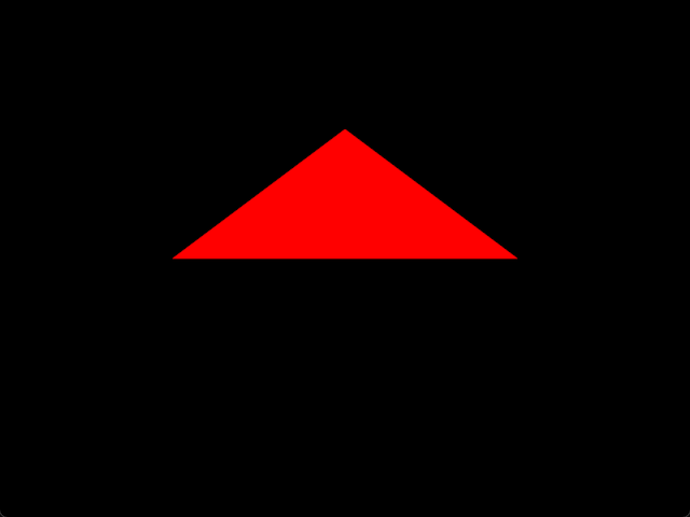
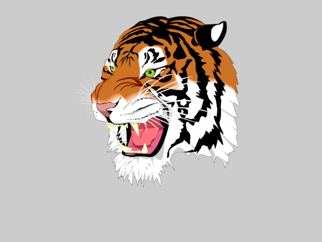
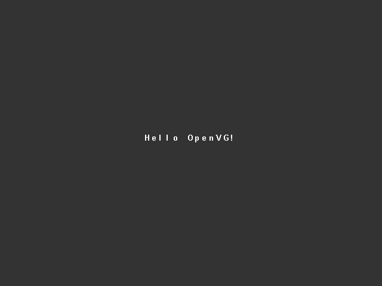
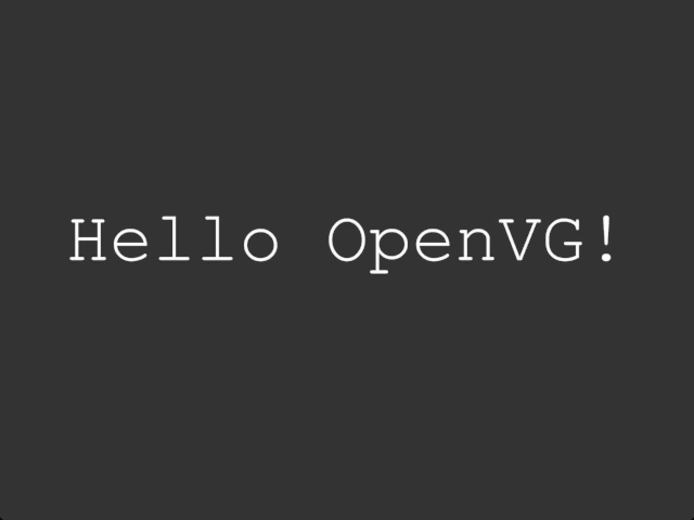

OpenVG
======

[](https://github.com/McNopper/OpenVG/actions/workflows/build.yml)

OpenVG 1.1 examples

## Changelog

### v1.0.3

Dependency pin update; no example changes, rendered output unchanged.

- **McNopper/EGL v1.0.14 -> v1.0.15** (via OpenVG_Library v1.0.3): the
  Wayland backend presents again - the OpenVG software buffer is copied to
  the compositor through `wl_shm`, where it was rendered but never shown
  before - and `eglSwapBuffers` reports a failed post as
  `EGL_BAD_NATIVE_WINDOW` per EGL 1.5 section 3.10.4 on every backend.

### v1.0.2

Dependency pin update; no example changes, rendered output unchanged.

- **McNopper/EGL v1.0.13 -> v1.0.14** (via OpenVG_Library v1.0.2): window
  surfaces are back-buffered again on Windows. v1.0.13 could back a window
  with a single-buffered pixel format, so GL windows stayed blank while
  running; OpenVG presents through EGL's software-buffer path, which that
  defect did not touch, but the stack stays on one fixed EGL release.

### v1.0.1

Dependency pin update; no example changes. All screenshots re-captured
against the new stack (rendered output unchanged).

- **McNopper/EGL v1.0.12 -> v1.0.13** (via OpenVG_Library v1.0.1): the
  dEQP-EGL conformance program (221 pass / 0 fail), the EGL 1.5 surface
  color space and the WGL sRGB fix that restores window surface creation
  on NVIDIA drivers.

### v1.0.0

The examples move to the McNopper/OpenGL build environment:

- **CMake build** modeled on McNopper/OpenGL: one `CMakeLists.txt` per
  example, `cppcheck`/`warnings` modules, executables in `VG_Binaries/`.
  Requires **GLUS v1.1.5** (the `OpenGL=VG` flavor).
- **EGL/OpenVG pair per platform**: the platform's own pair when it provides
  both (for example the Vivante GPU of the STM32MP1), otherwise
  [McNopper/EGL](https://github.com/McNopper/EGL) with
  [OpenVG_Library](https://github.com/McNopper/OpenVG_Library) - the software
  OpenVG implementation derived from the Khronos sources.
- **Legacy build systems removed**: Eclipse CDT projects, the vendored GLUS
  copy, the prebuilt `External/` libraries and the old vendor DLLs.
- **Screenshots** for every example.

## License

The project is distributed under the **MIT License** - see [`LICENSE`](LICENSE).

These examples are built on [GLUS](https://github.com/McNopper/GLUS) (MIT).
The dependencies **added by this repository** - McNopper/EGL (MIT) and
OpenVG_Library, whose implementation derives from the Khronos OpenVG 1.1
sources - are documented in [`THIRD-PARTY.md`](THIRD-PARTY.md).

## Build Instructions

### Prerequisites

**Required:**
- **CMake 3.14 or higher** - [Download](https://cmake.org/download/)
- **C/C++ Compiler**:
  - Windows: Visual Studio 2013+ (MSVC)
  - Linux: GCC or Clang
- **Git** - For fetching dependencies
- **EGL with an OpenVG client API** - provided by the platform, or by
  McNopper/EGL with OpenVG_Library (built automatically)

### Verify Installation

Check if CMake is installed:
```bash
cmake --version
```
Should show version 3.14 or higher.

### Building

GLUS is automatically fetched via CMake FetchContent, from the sibling local
checkout `../GLUS` when present (multi-repo development layout), and otherwise
from [github.com/McNopper/GLUS](https://github.com/McNopper/GLUS). When the
platform does not provide its own EGL/OpenVG pair, McNopper/EGL and
OpenVG_Library are fetched the same way.

**Windows (Visual Studio):**
```bash
mkdir build && cd build
cmake ..
cmake --build . --config Release
```

**Linux:**
```bash
mkdir build && cd build
cmake ..
make
```

Executables will be in the `VG_Binaries/` directory.

### Dependencies

- **GLUS v1.1.5** - Window/context boilerplate, math, image loading
- **McNopper/EGL v1.0.15** and **OpenVG_Library v1.0.3** - the EGL/OpenVG
  pair used when the platform does not provide its own

## Examples

All examples demonstrate OpenVG 1.1 rendering.

- [Example01_VG - Basic window and OpenVG initialization](#example01_vg---basic-window-and-openvg-initialization)
- [Example02_VG - Rendering of a triangle](#example02_vg---rendering-of-a-triangle)
- [Example03_VG - Rendering the Khronos tiger](#example03_vg---rendering-the-khronos-tiger)
- [Example04_VG - Bitmap font rendering](#example04_vg---bitmap-font-rendering)
- [Example05_VG - TTF font rendering using font2openvg output](#example05_vg---ttf-font-rendering-using-font2openvg-output)

### Example01_VG - Basic window and OpenVG initialization


### Example02_VG - Rendering of a triangle



### Example03_VG - Rendering the Khronos tiger



### Example04_VG - Bitmap font rendering



### Example05_VG - TTF font rendering using font2openvg output


